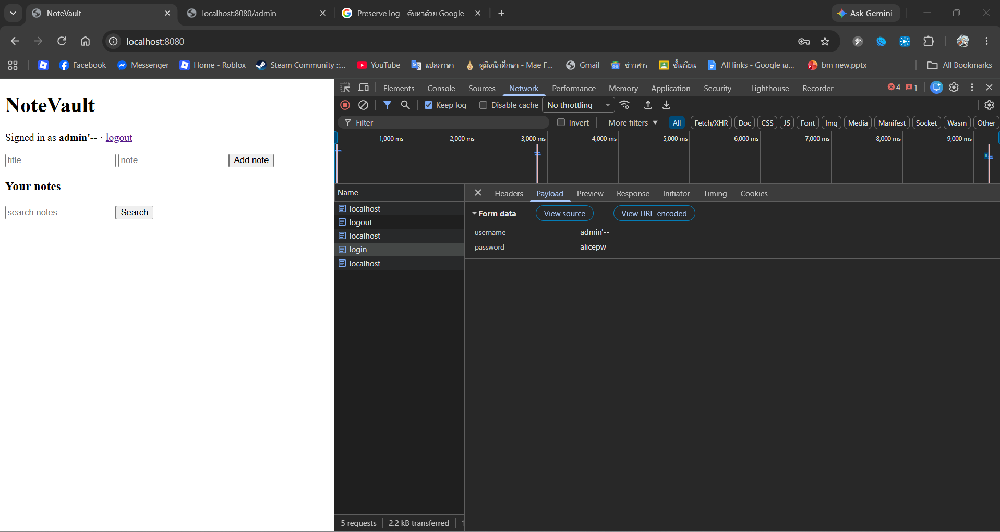
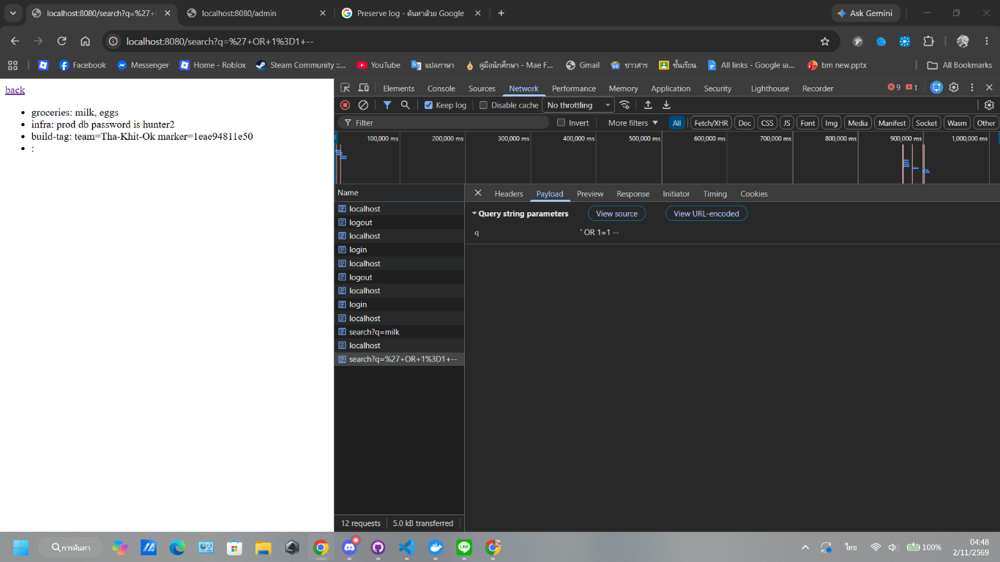
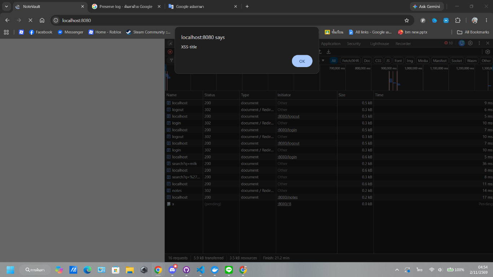
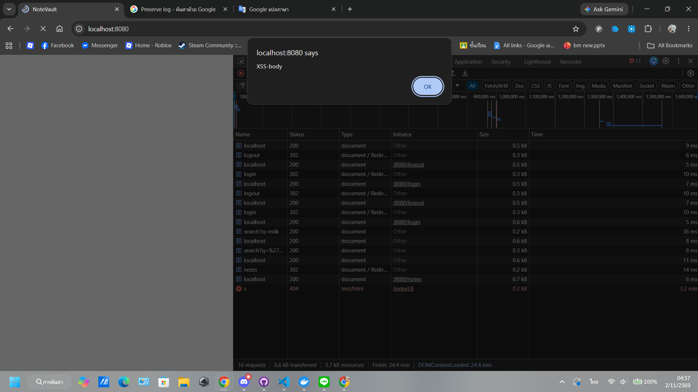
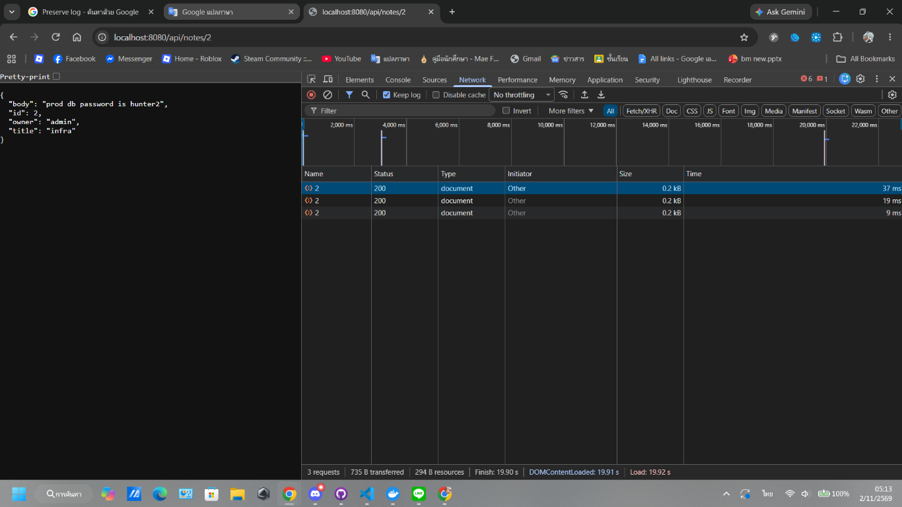
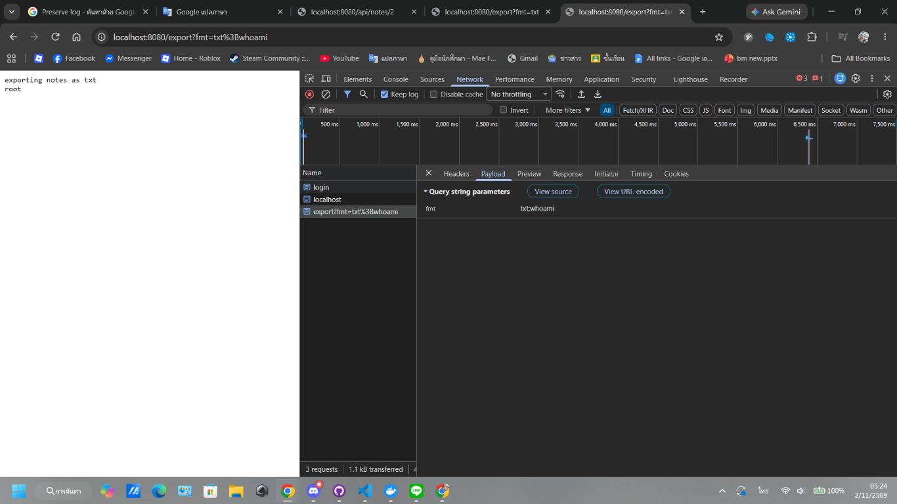
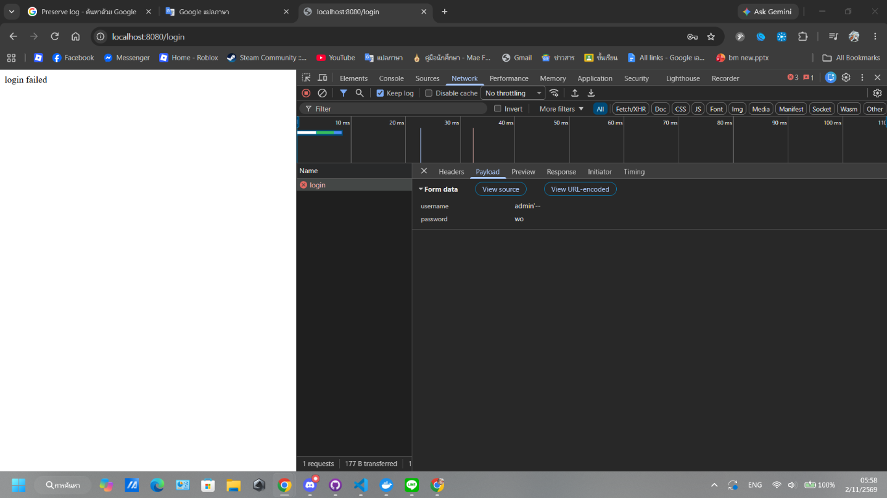

# Term Project Report — Secure Build

> Fill in every section. Keep the headings. Total **100 pts** (see rubric at the end).
> This is **team work** (2–3). Do not share your report with other teams.

## Cover

| Field | Value |
|---|---|
| Team name | |
| Members (name + ID) | |
| Target application | |
| Repository URL | |
| Demo video (unlisted YouTube / Google Drive link) | |
| Date | |

## AI-tool usage disclosure
*Academic integrity: state how you used any AI tools (ChatGPT, Copilot, etc.) — e.g. searching, coding, translating, drafting. "None" is a valid answer.*

| Tool | How it was used |
|---|---|
| | |

---

## 1. Executive Summary
*(½ page) What the app is, how many findings by severity, and the overall risk before vs. after your fixes.*

---

## 2. System Scope & Function
- What the application does; in-scope components and endpoints.
- **Data-Flow Diagram (DFD):** processes, data stores, external entities, **trust boundaries** (insert image).

---

## 3. Threat Model — STRIDE  *(20 pts)*

| Element / data flow | S | T | R | I | D | E | Top threat & mitigation |
|---|---|---|---|---|---|---|---|
| | | | | | | | |

*Then rank the top 5 risks by likelihood × impact.*

---

## 4. Vulnerability Findings  *(25 pts)*


### Finding F-05 — SQL Injection in Login
| Field | Value |
|---|---|
| CWE | CWE-89: Improper Neutralization of Special Elements used in an SQL Command |
| OWASP 2025 | A05:2025 – Injection |
| Severity | High |
| Location | `project/starter-app/app.py`, function `login()`, endpoint `POST /login` |
| Found by | `<ชื่อสมาชิกคนที่ 2> (<รหัสนักศึกษา>)` |
| Reproduction | 1. Open `http://localhost:8080`.<br>2. Submit `username=admin'--` and any password (the screenshot uses `alicepw`).<br>3. Observe that the login request succeeds and the page displays `Signed in as admin'--`.<br>4. The Network panel shows the submitted payload in the `POST /login` request. |
| Impact | The attacker can alter the SQL predicate and bypass the password check, causing the application to create an authenticated-looking session without the correct password. The captured evidence does **not** prove access to the real `admin` account because the JWT subject is built from the untrusted input (`admin'--`), so no admin privilege is claimed for this finding. |
| Root Cause | The login query is constructed by concatenating the username and password into SQL instead of binding them as parameters. |
| Evidence |  |

### Finding F-06 — SQL Injection in Search

| Field | Value |
|---|---|
| CWE | CWE-89: Improper Neutralization of Special Elements used in an SQL Command |
| OWASP 2025 | A05:2025 – Injection |
| Severity | High |
| Location | `project/starter-app/app.py`, function `search()`, endpoint `GET /search` |
| Found by | `<ชื่อสมาชิกคนที่ 2> (<รหัสนักศึกษา>)` |
| Reproduction | Login as `alice`, then request `/search?q=%27%20OR%201%3D1%20--%20`. The response reveals admin notes. |
| Impact | A logged-in user can bypass the intended owner filter and read notes belonging to other users, including sensitive data. |
| Root Cause | The search query concatenates the user-controlled `term` directly into SQL. |
| Evidence |  |

### Finding F-07 — Stored XSS in Notes and Search

| Field | Value |
|---|---|
| CWE | CWE-79: Improper Neutralization of Input During Web Page Generation |
| OWASP 2025 | A05:2025 – Injection |
| Severity | High |
| Location | `project/starter-app/app.py`, function `home()`, endpoint `POST /notes` |
| Found by | `<ชื่อสมาชิกคนที่ 2> (<รหัสนักศึกษา>)` |
| Reproduction | Login as `alice`, create a note with title `<script>alert('XSS-title')</script>`, then return to the home page. The browser executes the script and displays an alert. |
| Impact | Stored JavaScript executes whenever a user views the affected note. |
| Root Cause | Note data is concatenated into HTML and rendered using `|safe`, bypassing Jinja auto-escaping. |
| Evidence |   |


### Finding F-08 — IDOR in Note API

| Field | Value |
|---|---|
| CWE | CWE-639: Authorization Bypass Through User-Controlled Key |
| OWASP 2025 | A01:2025 – Broken Access Control |
| Severity | High |
| Location | `project/starter-app/app.py`, function `api_note()`, endpoint `GET /api/notes/<nid>` |
| Found by | `<ชื่อสมาชิกคนที่ 2> (<รหัสนักศึกษา>)` |
| Reproduction | 1. Login as `alice` using `alice/alicepw`.<br>2. Request `GET /api/notes/2`.<br>3. Observe HTTP 200 and a JSON response with `"owner": "admin"` and the admin note content. |
| Impact | An authenticated user can read another user's private note by changing the note ID. The response exposes sensitive data from the admin note. |
| Evidence |  |

### Finding F-09 — OS Command Injection in Export

| Field | Value |
|---|---|
| CWE | CWE-78: Improper Neutralization of Special Elements used in an OS Command |
| OWASP 2025 | A05:2025 – Injection |
| Severity | High |
| Location | `project/starter-app/app.py`, function `export()`, endpoint `GET /export` |
| Found by | `<ชื่อสมาชิกคนที่ 2> (<รหัสนักศึกษา>)` |
| Reproduction | Login as `alice`, then request `/export?fmt=txt%3Bwhoami`. The response contains `exporting notes as txt` followed by `root`. |
| Impact | An authenticated attacker can execute additional OS commands with the privileges of the container process. |
| Root Cause | The user-controlled `fmt` value is concatenated into a shell command executed with `shell=True`. |
| Evidence |  |


---

## 5. Remediation  *(25 pts)*


### Fix for F-05 — SQL Injection in Login

**Before**

```python
q = "SELECT * FROM users WHERE username = '%s' AND password = '%s'" % (
    username, hashlib.md5((password or "").encode()).hexdigest())
row = con.execute(q).fetchone()
```

**After**

```python
row = con.execute(
    "SELECT * FROM users WHERE username = ? AND password = ?",
    (username, hashlib.md5((password or "").encode()).hexdigest()),
).fetchone()
```

- **Why this fixes it:** The username and password hash are bound as SQL parameter values, so SQL metacharacters in the username cannot change the query structure.
- **Commit:** 
- **Proof the exploit now fails:** 

---

## 6. Supply-Chain Hardening  *(15 pts)*
- **SBOM** (CycloneDX) generated — attach `sbom.json`, note component count.
- **Artifact signed & verified** with Cosign — paste the `cosign verify` output.
- One-paragraph **SLSA** self-assessment (which level, why).

---

## 7. Security CI Pipeline  *(10 pts)*
- Link to the GitHub Actions workflow (SAST + SCA + secret scanning).
- Screenshot of a build **failing** on a HIGH/CRITICAL finding.
- How the gate is configured (what fails the build).

---

## 8. Conclusion & Reflection  *(5 pts — clarity)*
- Residual risks and what you'd harden next.
- Lessons learned.

---

## Appendix
- Tools used, references (OWASP/CWE links), and the team's task split.

---

## Grading rubric (100)

| Criterion | Pts |
|---|---|
| Threat model quality & completeness (§3) | 20 |
| Vulnerability findings — correctness, CWE/OWASP mapping, depth (§4) | 25 |
| Remediation quality — correct, minimal, well-explained (§5) | 25 |
| Supply-chain hardening — SBOM + signing + provenance (§6) | 15 |
| CI pipeline — works, fails build appropriately (§7) | 10 |
| Presentation & report clarity (§1, §8) | 5 |

*All work stays within the [ethics policy](../ETHICS.md).*
